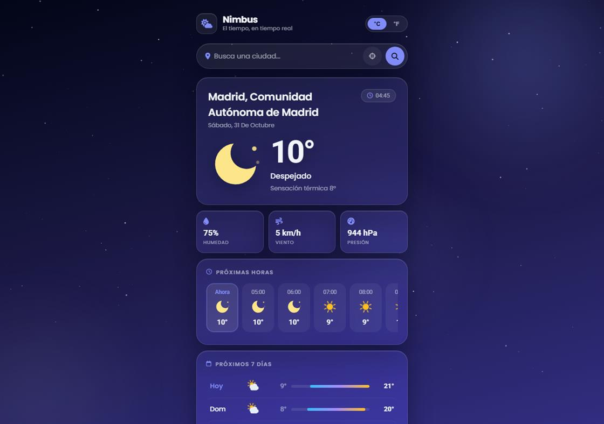
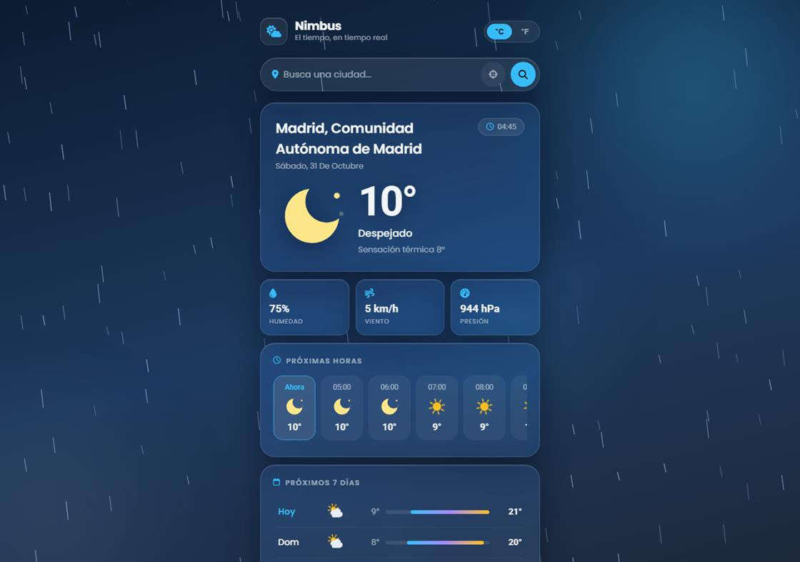
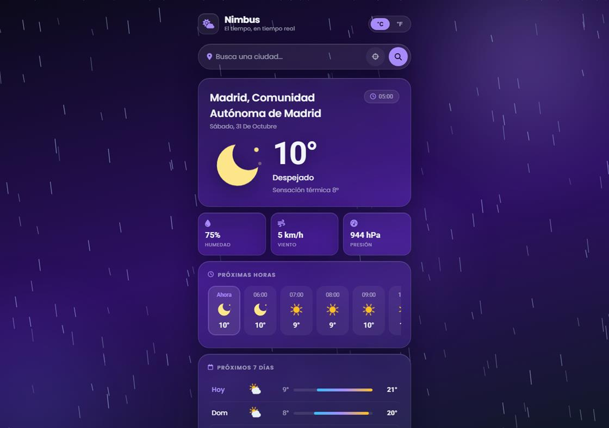
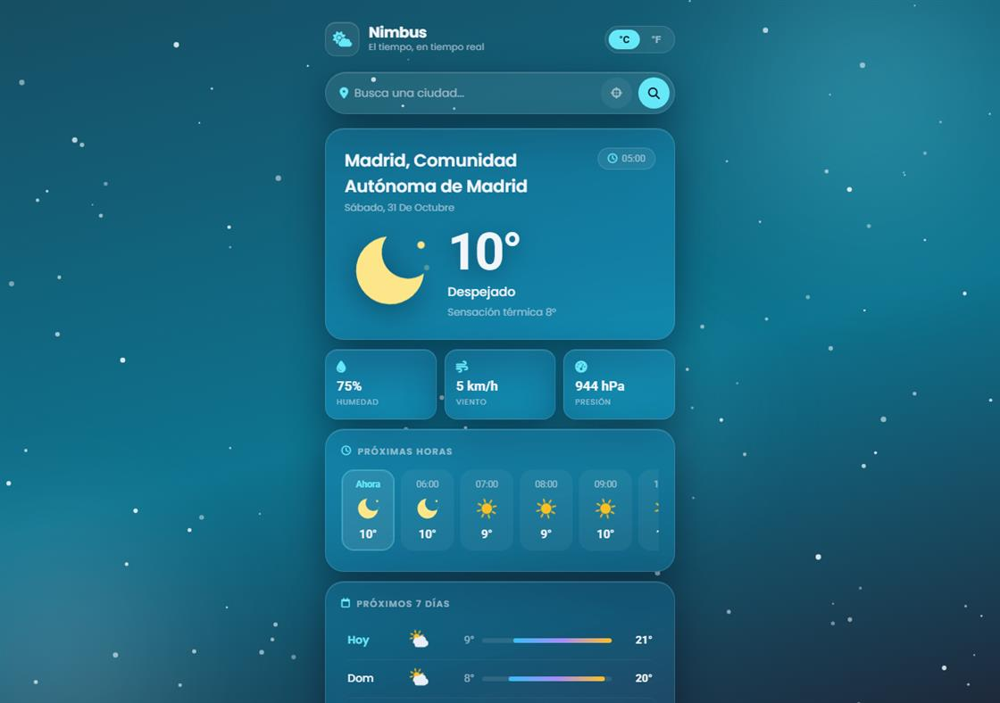

<p align="center">
  
</p>

<h1 align="center">Nimbus</h1>

<p align="center">
  Weather app for any city, with a background that changes with the conditions:<br>
  rain, snow, stars, fog or storms — behind a glassmorphism UI.
</p>

<p align="center">
  <a href="https://img.shields.io/badge/Vite-646CFF?style=flat&logo=vite&logoColor=white"></a>
  <a href="https://developer.mozilla.org/en-US/docs/Web/JavaScript"></a>
  <a href="https://open-meteo.com/"></a>
  <a href="./LICENSE"></a>
</p>

---

## ✨ What's different here

The background is part of the forecast, not decoration:

- 🎨 **10 dynamic themes** — the gradient, the accent color and the ambient light change with the conditions (clear day/night, partly cloudy, overcast, rain, snow, storm, fog).
- ✨ **Canvas particle engine** — hand-written particle systems per theme: rain streaks, drifting snowflakes, twinkling stars, soft bokeh, rolling mist… and lightning flashes during storms.
- 🖼 **Animated SVG weather icons** — drawn in code (rotating sun rays, falling drops, spinning flakes), no icon font or image assets.
- 🧊 **Glassmorphism UI** — translucent cards with `backdrop-filter`, soft inner highlights and staggered entrance animations.

## 🚀 Features

- 🔎 City search with **live suggestions** (type "Bog…" → pick Bogotá)
- 📍 One-click **geolocation**, and it remembers your last city
- 🌡 **°C / °F toggle** (persisted in `localStorage`)
- 🕙 **12-hour forecast** in a scrollable rail with a highlighted "Now"
- 📅 **7-day forecast** with min/max and temperature range bars
- 💧 Humidity · wind · pressure · feels-like
- 🔗 **Shareable links**: `?q=Bogota` opens straight on that city
- ⚡ Friendly error states (city not found, offline, geolocation denied)
- 📱 Mobile-first responsive layout (tested down to 360 px)
- ♿ Respects `prefers-reduced-motion`

## 🛠 Built with

| Layer | Tech |
|---|---|
| Markup | Semantic **HTML5** |
| Styling | **CSS3** — custom properties (theme engine), glassmorphism, Flexbox/Grid, keyframes |
| Logic | **JavaScript ES modules** — `fetch`/async-await, `Intl` for dates, Canvas API |
| Tooling | **Vite** (dev server + production build) |
| Data | [**Open-Meteo**](https://open-meteo.com) forecast + geocoding (free, no API key) · [BigDataCloud](https://www.bigdatacloud.net) reverse geocoding |

> **No API key, no `.env`.** Clone, install, run — it works out of the box. That was a deliberate choice so anyone who finds this repo can try it in seconds.

## ▶️ Getting started

```bash
git clone https://github.com/IsStevenDev/Weather---Web.git
cd Weather---Web
npm install
npm run dev
```

Open <http://localhost:5173> and search any city.

For a production build:

```bash
npm run build    # output in dist/, ready for any static host
npm run preview
```

## 🎛 Theme preview

The background follows the real weather, but you can force any theme with a URL parameter — a fun way to explore the design system:

| URL | Effect |
|---|---|
| `http://localhost:5173/?tema=rain` | Rain streaks + blue-slate gradient |
| `http://localhost:5173/?tema=snow` | Snowflakes + icy teal gradient |
| `http://localhost:5173/?tema=storm` | Heavy rain + lightning flashes + violet |
| `http://localhost:5173/?tema=clear-day` | Sun glow + golden accents |
| `http://localhost:5173/?tema=clear-night` | Twinkling stars + indigo night |
| `http://localhost:5173/?tema=fog` | Rolling mist + neutral gray |

Combine it with a city: `?q=Madrid&tema=storm`

| Rain | Storm | Snow |
|---|---|---|
|  |  |  |

## 📂 Project structure

```
Weather---Web/
├── images/
│   └── 404.webp          # error illustration
├── screenshots/          # README previews
├── src/
│   ├── css/
│   │   └── style.css     # theme variables, glassmorphism, animations
│   └── js/
│       └── index.js      # API, state, rendering, particle canvas
├── index.html
├── package.json
└── LICENSE
```

## ⚙️ How it works

1. **Geocode** the search text with Open-Meteo's geocoding endpoint.
2. **Fetch** current conditions, hourly and 7-day data in a single request.
3. **Map** the [WMO weather code](https://open-meteo.com/en/docs) to a description, an icon type, a theme and a particle mode.
4. **Render** the UI and crossfade the sky to the new palette.

The particle engine is a small class (`SkyFX`) that rebuilds its particle set whenever the theme changes and runs one `requestAnimationFrame` loop — no libraries.

## 🗺 Ideas for the future

- Favorite cities with local storage sync
- Weather alerts and precipitation probability
- Animated hourly chart (temperature curve)
- PWA install + offline cache

## 📄 License

Distributed under the [MIT License](./LICENSE).

## 👤 Author

**Steven Marimón** — [github.com/IsStevenDev](https://github.com/IsStevenDev)
